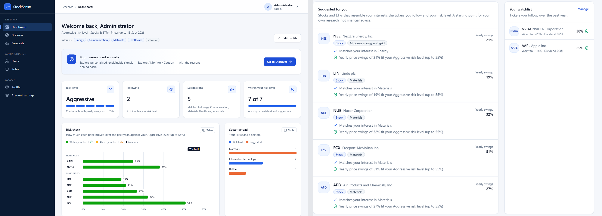
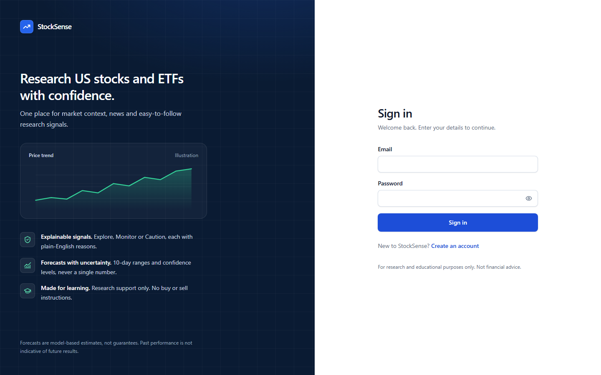
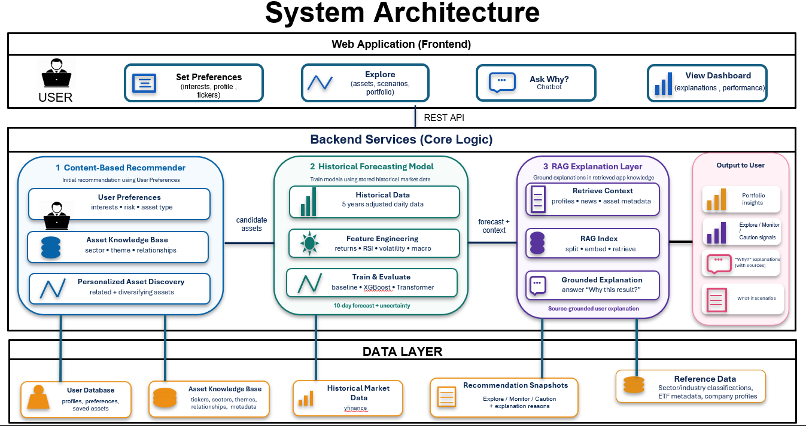

## SECTION 1 : PROJECT TITLE — StockSense: Explainable Stock Prediction and Research Report

**Explainable stock research for beginner investors.** StockSense helps new investors discover US stocks and ETFs that match their interests and risk level, and explains *why* with plain-English reasons. It is a research and learning tool: it never gives buy or sell instructions.

- **Live site:** https://stocksenseapp.azurewebsites.net/
- **Stack:** Next.js and React · FastAPI (Python) · PostgreSQL (Azure Database for PostgreSQL) · one Docker container on an Azure Web App



---

## SECTION 2 : EXECUTIVE SUMMARY / PAPER ABSTRACT

Retail platforms such as IBKR, moomoo, Plus500 and Robinhood have made US stocks and ETFs easy to buy, but beginner investors still face a hard research task. Price charts, market news, company filings, volatility and their own risk tolerance are spread across disconnected sources, and simple ratings rarely explain why a stock is recommended.

StockSense is a hybrid decision-support system that guides beginners through a short, explainable research journey. A new user completes onboarding — risk level, interests, preferred asset types and optional followed tickers. A **content-based recommender** then suggests stocks and ETFs that resemble that profile: each asset is described by its sector and themes (weighted with TF-IDF) and by its attributes and one-year risk figures, candidates are scored by cosine similarity to the user's interests and followed tickers, adjusted for how well their volatility fits the user's risk level, and every suggestion carries plain-English reasons.

For deeper research, each asset has a research view: a **10-trading-day XGBoost forecast** with an uncertainty range, a deterministic **rule-based signal** (Explore, Monitor or Caution) that also considers news sentiment and SEC fundamentals, and a **retrieval-augmented explanation** that cites recent news and company-filing extracts. The explanation only describes the signal; it never changes it. Labels guide research priority, not trading.

Data collection, feature preparation, model training and embedding run offline and in a nightly GitHub Actions job; the web application only reads the stored results from PostgreSQL. The application runs as a single Docker container on Azure, and every push to the main branch builds a new image.

---

## SECTION 3 : CREDITS / PROJECT CONTRIBUTION

| Official Full Name | Student ID (MTech Applicable) | Work Items (Who Did What) | Email (Optional) |
| :------------ |:---------------:| :-----| :-----|
| Ilanchezhiyan Bharathikannan | A0134740M | 1. Set up the project template and repository structure for the team: a layered backend API (routers, schemas, repositories, services, configuration and security), a frontend shell with shared components, an API client and sign-in, user and role pages, environment templates, Docker and docker-compose files, a CI workflow, a test setup and a setup guide, so every workstream could build on the same structure<br>2. Developed the content-based recommendation system: TF-IDF asset descriptions and scaled risk attributes compared by cosine similarity, adjusted for risk fit, with plain-English reasons for every suggestion<br>3. Packaged the frontend and backend into a single Docker image, with Next.js serving the pages and passing API calls to FastAPI inside the same container<br>4. Built the CI/CD pipeline: GitHub Actions builds the image on every push to main and pushes it to Azure Container Registry<br>5. Deployed and configured the Azure Web App, including its application settings and database connection<br>6. Migrated the backend from MongoDB to Azure Database for PostgreSQL<br>7. Implemented user accounts: registration, secure sign-in, roles and permissions, and administrator pages for users and roles<br>8. Built the onboarding / investor-profile flow capturing risk level, interests, asset types and up to 20 followed tickers<br>9. Created the dashboard (suggestions with reasons, risk check, sector spread and watchlist) and refreshed the UI with grouped navigation and an account menu<br>10. Integrated and reviewed all team members' code through pull requests into the main branch<br>11. Resolved technical issues the team faced during development, including container registry and deployment configuration, the move from MongoDB to Azure PostgreSQL and its database connectivity, and integration problems when merging teammates' work into the main branch | |
| Miti Bhatt | A0351590E | 1. Developed the forecasting and uncertainty pipeline<br>2. Engineered 27 predictors from returns, momentum, volatility, volume and broader market movement<br>3. Trained and evaluated mean/median baselines, Ridge, Elastic Net, PCA Ridge, Random Forest, Extra Trees, Histogram Gradient Boosting, XGBoost, ensembles and Chronos-2<br>4. Applied chronological walk-forward validation with separate model selection, calibration and evaluation periods to prevent future leakage<br>5. Selected and packaged XGBoost for saved-model inference<br>6. Produced calibrated uncertainty intervals for 10-session return forecasts<br>7. Integrated forecast results with PostgreSQL, FastAPI, the rule-based reasoning engine and the frontend dashboard<br>8. Contributed to technical presentation planning, documentation, visual design and video editing for the project demonstrations | |
| Akshata Dhuraji | A0355808U | | |
| Gudulkar Hrihaan Maruti | A0351764Y | 1. Developed the rule-based reasoning engine that assigns each asset an Explore, Monitor or Caution stance<br>2. Designed a safety-first decision list over forecast return, volatility, news sentiment, forecast uncertainty and sector concentration<br>3. Set volatility limits for five user risk profiles, from very conservative to aggressive<br>4. Recorded a decision trace and reason codes for every signal, so each stance can be audited<br>5. Handled missing and invalid inputs conservatively: missing sentiment cannot give Explore, and a missing forecast interval caps the stance at Monitor<br>6. Wrote 17 unit tests covering every rule and its boundary values<br>7. Fixed the backend API so the engine uses each asset’s own one-year volatility instead of a silent default, and returns a clear 422 error for invalid inputs<br>8. Contributed to integration testing of the rule engine with the rest of the system<br>9. Wrote the promotion video script and contributed screen clips and voiceover<br>10. Contributed the rule engine voiceover and decision tree visual for the system design video | |

---

## SECTION 4 : VIDEO OF SYSTEM MODELLING & USE CASE DEMO

### Business presentation

<a href="https://youtu.be/z-0iNIEYFbo" title="StockSense business presentation"></a>

The business case for StockSense: why beginner investors struggle to research US stocks and ETFs when prices, news, filings and risk information are spread across separate sources, how existing tools leave that gap open, and how StockSense closes it with one explainable research workflow — personalised discovery, explainable insights and risk-aware signals that guide research priority, never buy or sell decisions.

### Technical presentation (system modelling & use case demo)

<a href="https://youtu.be/OnKptqWFjJo" title="StockSense technical presentation"></a>

How StockSense is built and how it works, following the system architecture above. The **web application** (Next.js and React) lets the user set preferences, explore assets and view the dashboard. The **backend services** (FastAPI) combine three parts: a **content-based recommender** that matches assets to the user's interests, followed tickers and risk level; a **historical forecasting model** (XGBoost) that produces 10-day forecasts with uncertainty; and a **RAG explanation layer** that grounds the Explore / Monitor / Caution signal in retrieved news and company filings. The **data layer** in PostgreSQL holds user profiles, the asset knowledge base, historical market data, recommendation snapshots and reference data. The video also demonstrates the use cases in the running application and covers the tech stack and the Docker and Azure deployment.

---

## SECTION 5 : USER GUIDE

Installation and user guide for the live system and for running StockSense on your own machine.

### [ 1 ] Use the live system (nothing to install)

> Open https://stocksenseapp.azurewebsites.net/ in a web browser

| Account | Email | Password | Access |
| --- | --- | --- | --- |
| Administrator | `admin@example.com` | `ChangeMe123!` | Everything, including Users and Roles |
| Normal user | `user@example.com` | `User@12345` | Profile and account settings only |

Anyone can also create a normal account at **/register**. These are development passwords: change them (*Account settings*) before sharing the project.

1. **Register** a new account. The first sign-in opens the **Profile** (onboarding) page.
2. Choose a **risk level**, your **interests** (for example Technology and Clean Energy), stocks, ETFs or both, and optionally **tickers you follow** (for example NVDA), then click **Continue**.
3. The **Dashboard** shows *Suggested for you* — content-based suggestions, each with its reasons — plus a risk check, sector spread and 10-session forecasts for the suggestions.
4. **Discover** lists your personalised research set. Open an asset to see its forecast range, signal (Explore / Monitor / Caution), the reasons behind it, recent news and filing extracts.

### [ 2 ] Run the system on your own machine

You need **Python 3.11+**, **Node.js 20.9+**, and a **PostgreSQL** database (the team's Azure server, or a local one). Run the backend and the frontend in two terminals.

**Backend** (http://localhost:8000)

> $ cd backend

> $ python -m venv .venv

> $ .\.venv\Scripts\Activate.ps1          (macOS/Linux: source .venv/bin/activate)

> $ pip install -r requirements.txt

> $ cp .env.example .env                  (PowerShell: Copy-Item .env.example .env)

Open `backend/.env` and set the database connection and a secret:

```ini
POSTGRES_HOST=stocksensedb.postgres.database.azure.com
POSTGRES_PORT=5432
POSTGRES_DB=postgres
POSTGRES_USER=postgres
POSTGRES_PASSWORD=<the server's password>
POSTGRES_SSLMODE=require
JWT_SECRET_KEY=<any random string, 32+ characters>
```

The tables are created automatically when the API starts. Load the stock catalogue once, then start the server:

> $ python -m scripts.import_assets

> $ uvicorn app.main:app --reload --port 8000

**Frontend** (http://localhost:3000)

> $ cd frontend

> $ npm install

> $ npm run dev

> **Go to URL using web browser** http://localhost:3000 and sign in with one of the accounts above.

> The Azure PostgreSQL server's firewall must allow your IP address (*Networking* in the portal), or the backend cannot connect.

**Tests.** The backend tests drop and recreate a database named `stocksense_test`, so use a PostgreSQL server you can throw data away on. A local Docker container is easiest:

> $ docker run -d --name stocksense-pg -e POSTGRES_PASSWORD=localdev -p 5432:5432 postgres:16

> $ TEST_POSTGRES_PASSWORD=localdev pytest -q          (from backend/; also TEST_POSTGRES_HOST / _PORT / _USER / _SSLMODE)

### [ 3 ] Deployment

The app runs on Azure as a single container built from the root `Dockerfile`: Next.js serves the pages on the public port and proxies `/api/*` to FastAPI inside the same container. A push to the `main` branch runs GitHub Actions, which builds the image and pushes it to Azure Container Registry. The web app needs the `POSTGRES_*` settings above as App Service application settings, and the PostgreSQL firewall must allow Azure services. After a new image is pushed, restart the web app:

> $ az webapp restart -g mlprojectdocker -n stocksense-g13

A separate nightly GitHub Actions workflow refreshes prices, news and research snapshots in PostgreSQL. Forecasts are trained and produced offline, and the production app only reads the latest stored batch (see [`data/FORECASTING.md`](data/FORECASTING.md)).

### Project structure

| Folder | What it is |
| --- | --- |
| [`backend/`](backend/) | FastAPI API: authentication, users and roles, investor profile, assets, recommendations, dashboard, discovery and forecasts. Runs on port 8000. |
| [`frontend/`](frontend/) | Next.js web app: sign-in, onboarding, dashboard, Discover, forecasts, account settings and admin pages. Runs on port 3000. |
| [`data/`](data/README.md) | Offline data collection (prices, macro, news, SEC filings), feature preparation, forecasting, RAG and evaluation. See [`data/README.md`](data/README.md) and [`data/SHARED_DATA.md`](data/SHARED_DATA.md). |
| [`notebooks/`](notebooks/) | Research notebooks: content-based recommender, forecasting research and a Chronos zero-shot benchmark. |
| [`docs/`](docs/) | Design and data-quality notes ([`docs/ai`](docs/ai)) and UI screenshots. |

---

## SECTION 6 : PROJECT REPORT / PAPER

### 6.1 Business problem background

Low-cost trading apps and fractional investing have brought many first-time investors into the US market. Information is not the problem: prices, technical indicators, news, analyst research and company filings are all available. Beginners struggle to **combine** them — to see how news relates to price movement, how risky an asset is for them, and how uncertain any forecast is. Most tools give a chart, a rating or a single predicted number without showing their reasoning, which leads to information overload, guesswork and poorly matched risk.

### 6.2 Market research

- Mainstream platforms (Yahoo Finance, Apple Stocks, brokerages such as IBKR) offer plenty of raw data and indicators, but their interfaces are not designed for beginners, and personal advisory services are expensive.
- AI-assisted investing is growing fast — estimated at roughly US$14–19 billion in 2026, with forecasts above US$50 billion by 2030 — but the market splits between expensive institutional terminals and free, general-purpose chatbots.
- General chatbots cannot show their reasoning or their uncertainty, and current tools analyse price trends and news sentiment in separate silos.
- **The gap:** a dedicated, explainable research layer for beginners that brings relevance, evidence and uncertainty together in one bounded workflow.

### 6.3 Project objectives & success measurements

| Objective | How StockSense meets it | How it is measured |
| --- | --- | --- |
| Help beginners discover relevant stocks and ETFs | Onboarding profile + content-based recommender with reasons | Persona checks in the recommender notebook; recommender unit tests |
| Show short-term forecasts with visible uncertainty | XGBoost 10-session return forecasts with calibrated intervals | Walk-forward MAE/RMSE, direction accuracy and interval coverage against baselines |
| Give transparent research signals | Deterministic Explore / Monitor / Caution rule engine with a decision trace | Rule-engine unit tests on each rule and threshold |
| Explain signals with evidence | RAG layer that cites news and filing extracts, or abstains | Grounding guardrails; text and sentiment-attribution gates |
| Reduce information overload | One dashboard and one research view per asset | Use-case walkthroughs in the videos |
| Support safe learning | No buy / sell instructions anywhere; research labels only | Disclaimers in the UI, API and explanations |

### 6.4 Project solution

**Architecture.** A three-tier design (see the architecture diagram in Section 4): a Next.js and React web application; FastAPI backend services; and a PostgreSQL data layer holding users and profiles, the asset knowledge base, historical market data, recommendation snapshots and reference data. Offline jobs prepare data and models; the web application only reads stored results.

**Knowledge representation.** A curated catalogue of 90 US stocks and ETFs. Each asset carries a category, a sector, a list of themes (for example *artificial_intelligence*, *renewable_energy*) and one-year risk figures (volatility, beta, maximum drawdown, dividend yield). Onboarding interests are defined in terms of the same sectors and themes, so every interest is backed by real assets.

**1 · Content-based recommender** (scikit-learn). Each asset is described twice: a text description (category, sector and themes) weighted with **TF-IDF**, and an attribute vector (one-hot sector, category and asset type, multi-hot themes and the risk figures, min-max scaled to 0–1). Each interest becomes a TF-IDF query and each followed ticker becomes a reference point in the attribute space. Candidates are scored with **cosine similarity** — 50% similarity to the interests, 30% similarity to the followed tickers and 20% fit between the asset's volatility and the user's risk level (full fit up to the level's limit, falling to zero at twice the limit). Every suggestion lists its reasons in plain English, for example *"Matches your interest in Technology"*, *"Similar to NVDA, which you follow"*, *"Yearly price swings of 46% are above your Moderate risk level"*.

**2 · Historical forecasting model.** 27 predictors from past returns, momentum, volatility, volume and broader market movement (SPY returns, VIX). Mean/median baselines, Ridge, Elastic Net, PCA Ridge, Random Forest, Extra Trees, Histogram Gradient Boosting, XGBoost, ensembles and Chronos-2 were compared with chronological walk-forward validation, using separate periods for model selection, calibration and evaluation to prevent leakage. XGBoost was packaged for the application; it produces 10-session return forecasts with conformal-style 90% intervals.

**3 · Rule-based reasoning engine.** A deterministic, auditable layer that turns the forecast, volatility, news sentiment, interval width and sector concentration into **Explore / Monitor / Caution**. Caution rules are checked first (negative forecast, volatility above the user's limit, bearish sentiment). Explore needs every condition to align (a strong forecast, bullish sentiment, low uncertainty, no concentration). Everything else is Monitor. Point-in-time SEC fundamentals can move the stance by one step, but never lift a Caution. Every decision records a reason-coded trace.

**4 · RAG explanation layer.** News and SEC filing text is split into chunks and embedded with `sentence-transformers/all-MiniLM-L6-v2` into **pgvector**. Retrieval combines semantic search with PostgreSQL full-text search (Reciprocal Rank Fusion), removes duplicate stories and **abstains** when nothing is relevant enough. The *"Why this signal?"* explanation is built from the rule engine's trace plus the retrieved evidence, with citations. It explains the signal; it never changes it.

### 6.5 Project implementation

- **Team workflow:** feature branches and pull requests on GitHub, integrated and reviewed into `main`.
- **Data pipeline:** Python collectors for prices and macro data (yfinance, FRED), news (Alpha Vantage, Marketaux) and SEC filings and XBRL fundamentals (SEC EDGAR); preparation scripts; an offline forecasting package; embedding and snapshot jobs. A nightly GitHub Actions workflow refreshes prices, news and research snapshots in PostgreSQL.
- **Application:** FastAPI routers for authentication, users and roles, profile, assets, recommendations, dashboard, discovery and forecasts; Next.js pages for sign-in, onboarding, dashboard, Discover, forecasts, account settings and administration.
- **Deployment:** one Docker image (Next.js plus FastAPI), built by GitHub Actions on every push to `main`, pushed to Azure Container Registry and run on an Azure Web App with Azure Database for PostgreSQL.
- **Testing:** over 200 automated tests across the backend (API, authentication, roles, profile, recommender, rule engine, discovery, dashboard) and the data pipeline, plus independent data-quality gates (Section 7).

### 6.6 Project performance & validation

**Forecasting** (XGBoost, walk-forward evaluation, 10-session returns):

| Evaluation year | MAE (pp) | RMSE (pp) | Direction accuracy | Always-up baseline | 90% interval coverage |
| --- | --- | --- | --- | --- | --- |
| 2024 | 4.69 | 7.13 | 57.72% | 57.72% | 91.94% |
| 2025 | 5.10 | 7.25 | 56.61% | 56.61% | 92.93% |
| 2026 (partial) | 5.79 | 8.35 | 52.67% | 52.67% | 86.93% |

The intervals are close to their nominal 90% coverage, but direction accuracy equals simply predicting "up" and the error is only slightly lower than the baselines. Forecasts are therefore shown as **experimental**, with their uncertainty, and an asset with a too-wide interval cannot be labelled Explore.

**Recommender.** The notebook checks the design step by step: without min-max scaling, raw beta dominates the distances and pairs unrelated assets; a naive TF-IDF that splits sector names into words ranks oil majors for a *Clean Energy* interest, which the single-token design avoids; and persona tests (for example a conservative Healthcare investor and a growth Technology investor who follows NVDA and MSFT) return sensible, explained suggestions. 13 unit tests cover the recommender.

**Rule engine and RAG.** Unit tests cover each rule, threshold and risk level. The explanation layer must cite retrieved sources or abstain, and an optional LLM rephrasing must pass a guardrail check or fall back to the template.

**Data quality.** Independent numeric, text and storage gates reviewed the collected data before it was used; company-level news sentiment was found to be thin, so news-aware signals abstain where coverage is missing.

### 6.7 Project conclusions: findings & recommendations

- **Explainability builds trust.** Simple, transparent methods — TF-IDF, cosine similarity and explicit rules — let every suggestion and signal explain itself, which suits beginner investors better than an opaque score.
- **Short-term returns are hard to predict.** Forecast errors are only slightly better than baselines, so StockSense presents forecasts as uncertain inputs to the research signal, never as instructions.
- **Separating the parts keeps them honest.** The recommender ranks by resemblance, the forecaster estimates uncertainty, the rule engine decides the label and RAG only explains it.
- **Recommendations for future work:** expand the asset universe; add richer features (news, macro, fundamentals) to forecasting; collect user feedback to evaluate the usefulness of suggestions; and add the planned *Ask Why?* chatbot and what-if scenarios.

### 6.8 Mapping of system functionalities to the course modules

| Course module | Techniques used in StockSense |
| --- | --- |
| Machine Reasoning (MR) | Asset knowledge base; deterministic rule-based engine (Explore / Monitor / Caution) with reason-coded decision traces |
| Reasoning Systems (RS) | Content-based recommender (TF-IDF, cosine similarity, risk fit); machine-learning forecasting with walk-forward validation and uncertainty; hybrid reasoning combining ML outputs with rules |
| Cognitive Systems (CGS) | Text embeddings and semantic retrieval (pgvector), news sentiment, grounded natural-language explanations (RAG) |

### 6.9 Individual project reports

Each member's individual report (personal contribution, most useful learning and how it applies elsewhere) is submitted separately.

### 6.10 References

- Alpha Vantage. *Market news and sentiment API.* https://www.alphavantage.co/
- Marketaux. *Financial news API.* https://www.marketaux.com/
- U.S. Securities and Exchange Commission. *EDGAR full-text and XBRL data.* https://www.sec.gov/edgar
- Federal Reserve Bank of St. Louis. *FRED economic data.* https://fred.stlouisfed.org/
- yfinance. *Yahoo Finance market data for Python.* https://github.com/ranaroussi/yfinance
- Chen, T. and Guestrin, C. (2016). *XGBoost: A Scalable Tree Boosting System.* KDD 2016.
- Ansari, A. F. et al. (2024). *Chronos: Learning the Language of Time Series.* arXiv:2403.07815.
- Reimers, N. and Gurevych, I. (2019). *Sentence-BERT.* EMNLP 2019 (model: all-MiniLM-L6-v2).
- pgvector. *Open-source vector similarity search for Postgres.* https://github.com/pgvector/pgvector
- Pedregosa, F. et al. (2011). *Scikit-learn: Machine Learning in Python.* JMLR 12.

---

## SECTION 7 : MISCELLANEOUS

### docs/ai — design notes and data-quality gates

| File | What it contains |
| --- | --- |
| [`DATA_GATE.md`](docs/ai/DATA_GATE.md) | Overall data-readiness decision after independent review of the numeric inputs, text evidence and storage |
| [`NUMERIC_GATE.md`](docs/ai/NUMERIC_GATE.md) | Independent checks of the price and macro datasets and the numeric features |
| [`TEXT_GATE.md`](docs/ai/TEXT_GATE.md) | Independent checks of the prepared news and SEC filing text |
| [`STORAGE_GATE.md`](docs/ai/STORAGE_GATE.md) | Snapshot identity and reproducibility of the stored data |
| [`SENTIMENT_ATTRIBUTION.md`](docs/ai/SENTIMENT_ATTRIBUTION.md) | Why some news sentiment was attributed to the wrong ticker, and why news-aware signals abstain where coverage is thin |
| [`OPERATIONAL_MODEL.md`](docs/ai/OPERATIONAL_MODEL.md) | How the nightly batch, the signal and the RAG explanations fit together |
| [`PLAN.md`](docs/ai/PLAN.md) | Work plan and decisions, such as adding SEC fundamentals to the hybrid engine |

### notebooks — research and experiments

| Notebook | What it contains |
| --- | --- |
| [`content_based_recommender.ipynb`](notebooks/content_based_recommender.ipynb) | Step-by-step build and checks of the recommender: data understanding, attribute scaling, cosine similarity, TF-IDF design, the profile learner and persona tests |
| [`forecasting_research.ipynb`](notebooks/forecasting_research.ipynb) | Forecasting experiments: features, candidate models, walk-forward evaluation and uncertainty intervals |
| [`chronos2_zero_shot_benchmark.ipynb`](notebooks/chronos2_zero_shot_benchmark.ipynb) | Zero-shot Chronos-2 forecasts as a pretrained baseline for comparison |

### Other documentation

- [`data/README.md`](data/README.md) — data collection and preparation.
- [`data/FORECASTING.md`](data/FORECASTING.md) — the forecasting pipeline, evaluation and importing results.
- [`data/SHARED_DATA.md`](data/SHARED_DATA.md) — loading the prepared data into PostgreSQL.

---

**This project is part of the Practice Module of the Graduate Certificate in [Intelligent Reasoning Systems (IRS)](https://www.iss.nus.edu.sg/stackable-certificate-programmes/intelligent-systems "Intelligent Reasoning Systems"), offered by [NUS-ISS](https://www.iss.nus.edu.sg "Institute of Systems Science, National University of Singapore").**
